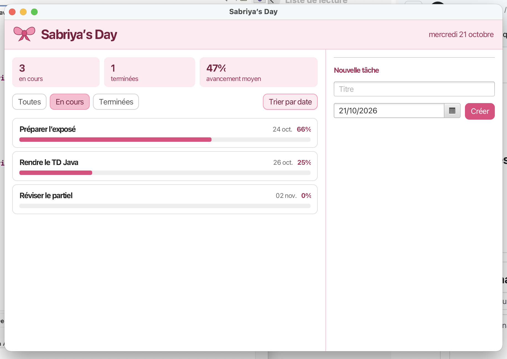

# Sabriya’s Day

Application de bureau (JavaFX) pour organiser et suivre ses tâches quotidiennes.

## Fonctionnalités

- Ajouter une tâche avec une date
- Ajouter des étapes à une tâche
- Voir l’avancement de chaque tâche en pourcentage
- Valider une tâche terminée
- Filtrer : toutes, en cours, terminées
- Trier les tâches par date
- Statistiques en haut de l’écran (tâches en cours, terminées, avancement moyen)
- Sauvegarde automatique dans un fichier texte

## Structure du projet

- Etape, Tache, Filtre, GestionnaireTaches : le modèle (données et règles)
- Sauvegarde : lecture et écriture du fichier de tâches
- AppTaches : l’interface JavaFX
- style.css : le style de l’application

## Lancer le programme

Ouvrir le projet dans Eclipse avec JavaFX configuré, puis exécuter AppTaches.

## Technologies

- Java 
- JavaFX
- CSS JavaFX

# Sabriya's Day 

